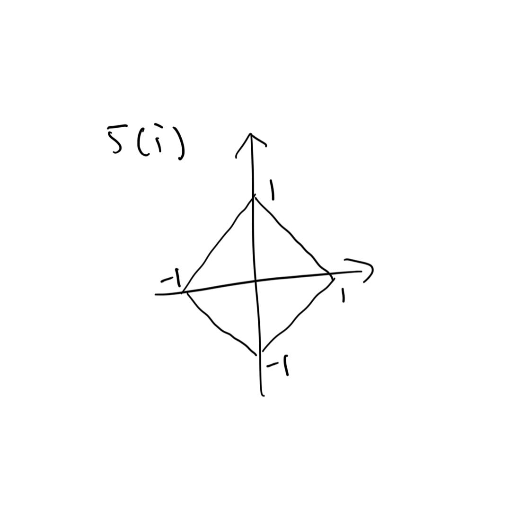
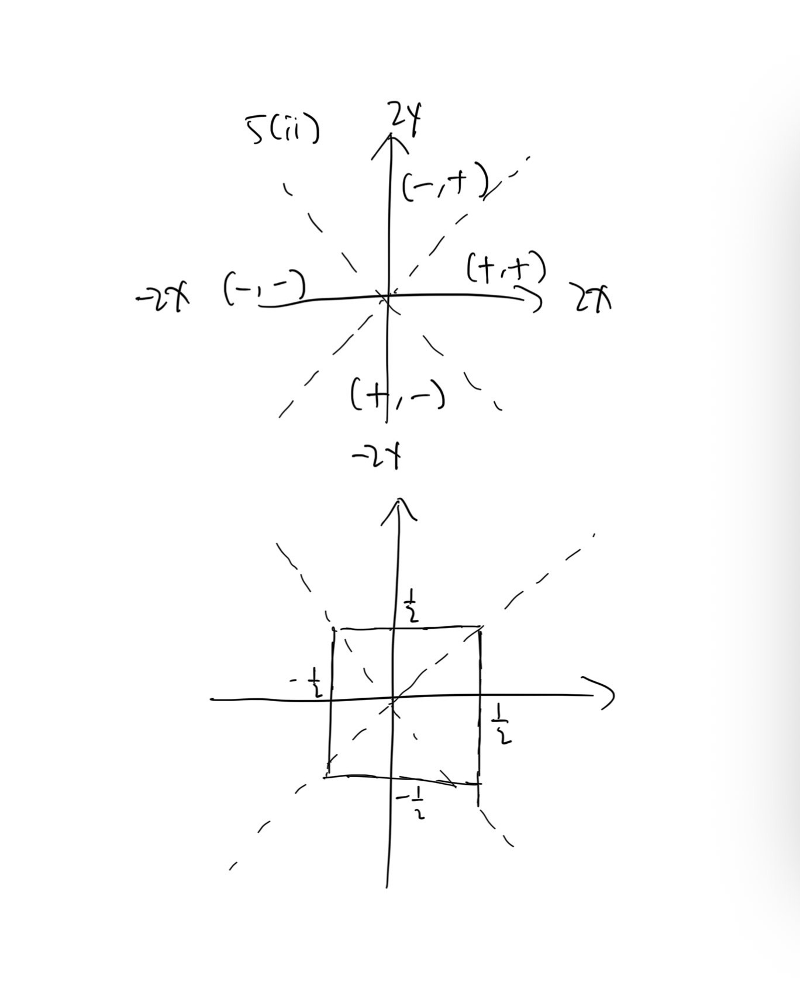
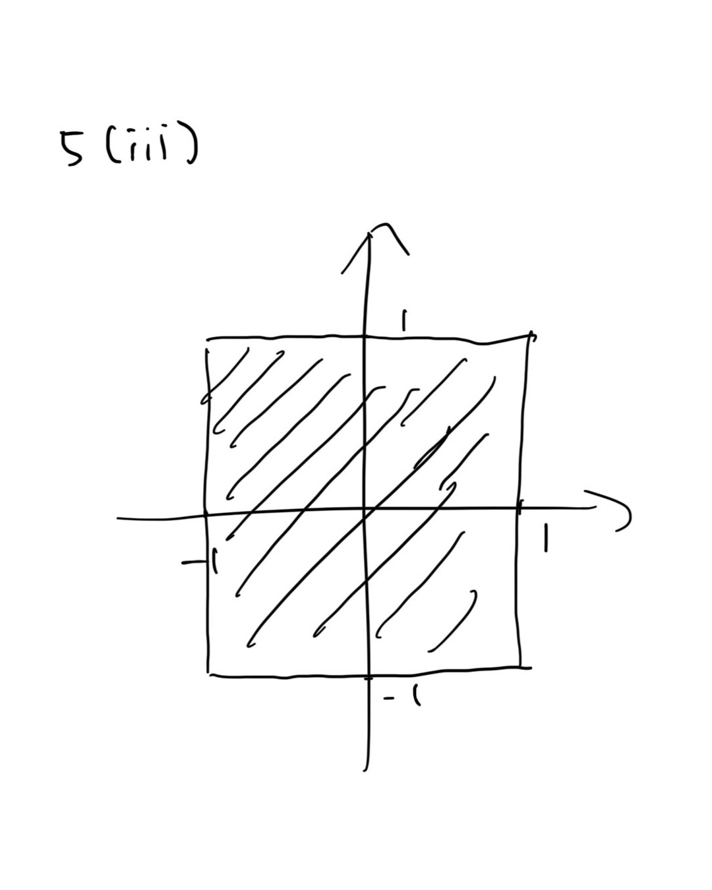

+++
# TOML Frontmatter
completed = 2026-10-16
+++

# Sheet 1

1. (i) Multiply by $a^{-1}$ on both sides since $a \ne$ 0 and $\R$ is a field.
   
   (ii) $\R$ is a field and therefore an integral domain, thus it has no zero-factors.
   
   (iii) $(-a) + (-b) + (a + b) = (-a) + a + (-b) + b = 0$ .
   
   (iv)
   
   $$
   \begin{align*}
& a \ge b
\\ \iff & a - b \in \R_{\ge0}
\\ \iff & (a + c) - (b + c) \in \R_{\ge0}
\\ \iff & a + c \ge b + c
\end{align*}
   $$
   
   (v)
   
   > **Lemma** $a : \R$ , $a \in \R_{>0} \implies -(-a) \in \R_{>0}$ .
   > 
   > **Proof** $a \in \R_{>0} \implies a \ne 0 \land (-a) \notin \R_{>0}$ , and $-a \ne 0$ because $a \ne 0$ , then $-(-a) \in \R_{>0}$ since exactly one of $-a \in \R_{>0}$ , $-a = 0$ , and $-(-a) \in \R_{>0}$ is true. $\square$ 
   
   $$
   \begin{align*}
& a < b \land c < 0
\\
\implies & b - a \in \R_{>0} \land -c \in \R_{>0}
\\ \implies & (b-a)(-c) \in \R_{>0}
\\ \implies & -(-(b-a)(-c)) \in \R_{>0}
\\ \implies & (a-b)c \in \R_{>0}
\\ \implies & ac > bc \space \square
\end{align*}
   $$

2. $$
   \begin{align*}
a^{k + 1} & = 
\exp ((k + 1) \ln a)
\\ &= \exp (k \ln a + \ln a)
\\ & = \exp (k \ln a) \exp(\ln a)
\\ &= a^ka \space  \square
\end{align*}
   $$
   
   $$
   \begin{align*}
a^{m + n} & = \exp ((m + n) \ln a)
\\ &= \exp(m \ln a + n \ln a)
\\ &= \exp(m \ln a ) + \exp( n \ln a)
\\ &= a^m a^n \space \square
\end{align*}
   $$

3. (i) $a \ge 0 \land b \ge 0 \lor a \le 0 \land b \le 0 \implies |a+b|=|a|+|b|$ directly by expanding the definition of absolute value. The inverse is obvious when $a=0$ or $b = 0$ , so we now assume $ab \ne 0$ .
   
   If $a>0$ and $b>0$ or vice versa it is done. Because $a$ and $b$ are symmetric, we assume $a > 0 > b$ .
   
   $$
   \begin{align*}
&|a + b| = |a| + |b|
\\ \iff & |a+b| = a - b
\\ \iff & a + b = a - b \lor -a - b = a - b
\\ \iff & b = 0 \lor a = 0
\\ \iff & \text{False} \space \square
\end{align*}
   $$
   
   (ii)
   
   Define
   
   $$
   \max(a, b) : \R \times \R \to \R =
\begin{cases}
a & a \ge b \\
b & \text{otherwise}
\end{cases}
   $$
   
   It is well-defined because $\R$ is total-ordered.
   
   $$
   \begin{align*}
& \max(a, b) = \frac 1 2 (a + b) + \frac 1 2 |a - b| 
\\ \iff & a \ge b \land  a= \frac 1 2 (a + b) + \frac 1 2 |a - b| 
\\ & \lor a < b \land b =  \frac 1 2 (a + b) + \frac 1 2 |a - b| 
\\ \iff & a = \frac 1 2 (a + b) + \frac 1 2 (a - b) \lor 
b = \frac 1 2 (a + b) - \frac 1 2 (a - b)
\\ \iff & \text{True} \space \square
\end{align*}
   $$

4. $$
   4 <
\left(
\begin{cases}
(x + 2) + (x - 1) & x \ge 1\\
(x + 2) - (x -1) & -2 \le x < 1\\
-(x + 2) - (x - 1) & x < -2
\end{cases}
\right)
< 5
   $$
   
   $$
   x \in (-3, -\frac 5 2) \cup (\frac 3 2, 2)
   $$

5. (i) Handwritten.
   
   
   
   (ii) Handwritten.
   
   
   
   (iii) Handwritten.
   
   

6. (i)
   
   $$
   \begin{align*}
& a_n \le a_{n + 1}
\\ \iff & \left (1 + \frac 1 {n + 1} \right)^{n + 1}
\ge \left (1 + \frac 1 n  \right)^n
\\ \iff & \frac{(n + 2)^{n + 1}} { (n + 1)^{n + 1} }
\ge \frac{ (n + 1) ^n }{n^n}
\\ \iff & \frac{n^{n + 1}  (n + 2)^{n + 1}} { (n + 1)^{n + 1} }
\ge n(n + 1)^n
\\ \iff & \frac{n^{n + 1}  (n + 2)^{n + 1}} { (n + 1)^{2(n + 1)} }
\ge \frac n {n + 1}
\\ \iff & \left( \frac { n(n+2) } {(n+1)^2 } \right) ^{n + 1}
\ge \frac n {n + 1} \space \square
\end{align*}
   $$
   
   (ii)
   
   $$
   \begin{align*}
\left( \frac { n(n+2) } {(n+1)^2 } \right) ^{n + 1}
& = \left( 1 - \frac{1}{(n+1)^2} \right)^{n + 1}
\\ & \ge 1 - (n+1) \frac{1}{(n + 1)^2}
\\ &= \frac n {n + 1} \space \square
\end{align*}
   $$
   
   (iii)
   
   Similar to (i):
   
   $$
   b_{n + 1} \le b_n \iff
\left(
\frac {(n + 1)^2}{n(n+2)}
\right)^{n + 1}
\ge \frac {n + 2}{n + 1}
   $$
   
   And
   
   $$
   \begin{align*}
\left(
\frac {(n + 1)^2}{n(n+2)}
\right)
& = \left(
1 + \frac{1}{n(n +2)}
\right)^{n + 1}
\\ &\ge 1 + \frac{n + 1}{n(n + 2)}
\\ & \ge 1 + \frac{1}{n + 1}
\\ &= \frac{n + 2}{n + 1} \space \square
\end{align*}
   $$
   
   (iv) $a_n \le b_n$ $\forall n \in \N^*$ .
   
   By induction, $a_m \le b_n$ $\forall m, n \in \N^*$ because
   
   - It obviously holds when $m, n \le 1$ ; and
   
   - If it holds $\forall m, n \le N$ , then $b_{N+1} \ge b_N \ge a_i$ $\forall i \in \N_{\le N}$ and $a_{N+1} \le a_N \le b_i$ $\forall i \in \N_{\le N}$ , so it also holds for $m,n \le N+1$ .
   
   $a_n \le b_5 = \frac{46656}{15625} < 3$ $\forall n \in \N^*$ $\square$ .
