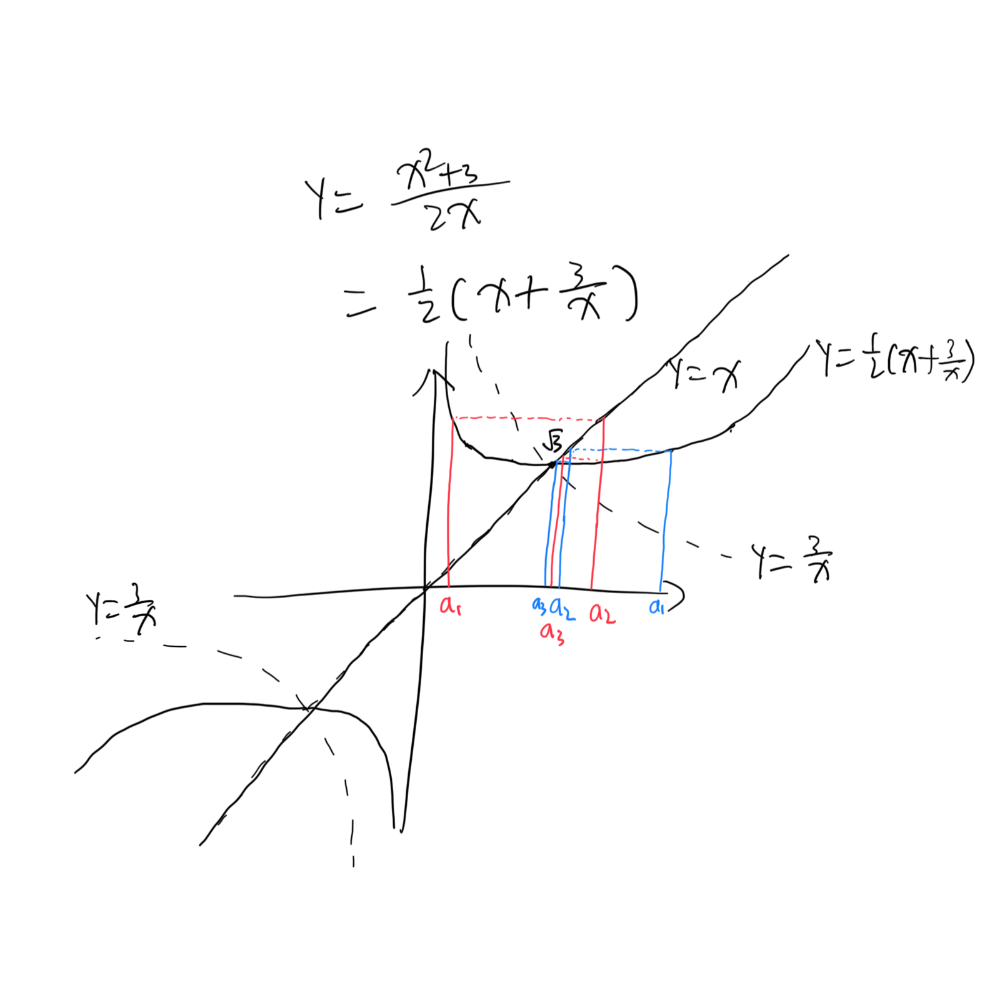

+++
# TOML Frontmatter
completed = 2026-10-19
+++

# Analysis I — Sheet 4

1. (i) $\frac{n^2 + n + 1}{n + 1} = \Omicron(n)$ diverges.
   
   (ii) $\frac{n + 1}{n^2 + n + 1} = \frac{1}{\Omicron(n)} \to 0$ .
   
   (iii) $\frac{3n^3 + n^2 \sin n}{2n^3 - 100n - 3} = \frac{\Omicron(3n^3)}{\Omicron(2n^3)} \to \frac3 2$ .
   
   (iv) $\frac{2^nn^2 + 3^nn}{3^n (n + 1) + n^7} = \frac{\Omicron(3^nn)}{\Omicron(3^nn)} \to 1$ .
   
   (v) $\sqrt{n + 1} - \sqrt n = \frac{1}{\sqrt{n + 1} + \sqrt n } = \Omicron (\frac{1}{2\sqrt n}) \to 0$ .
   
   (vi) Obviously ${2n \choose n} > n$ . Then $\frac{(n!)^2}{(2n)!} = \frac{1}{2n \choose n} < \frac{1}{\Omicron(n)}$ and tends to $0$ .

2. Let $I_k = [\frac{(3k-1)\pi}{3}, \frac{(3k+1)\pi}{3}]$ . It is obvious that the interval contains at least one integer, and $\cos(I_k) = [\frac 1 2, 1]$ for $k \equiv 0 \mod 2$ and $\cos(I_k) = [-1, -\frac 1 2]$ for  $k \equiv 1$ . Let $\nu(I_k)$ denote the smallest integer in $I_k$ .
   
   Let $\varepsilon = \frac 1 4$ , and we claim that $\forall L \in \R,  N \in \N$ , $\cos (\nu(I_{2N}) ) \in [\frac 1 2, 1]$ and $\cos(\nu(I_{2N+1})) \in [-1 ,-\frac 1 2] $ can not both be within $(L-\varepsilon, L + \varepsilon)$ . $\square$ 

3. If $L<0$ , let $\varepsilon = |L|$ and no term is within the error $\varepsilon$ to $L$ .
   
   Given $\varepsilon > 0$ , let $e$ be sufficiently small that $e^2 + 2e \varepsilon^2 < 2L\varepsilon^2$ . This implies $\frac{e}{2\sqrt{L - e} } < \varepsilon$ . Because $a_n \to L$ , $\exist N \in \N$ s.t. $|a_n -L| < e$ $\forall n \ge N$ . Then $|\sqrt{a_n} - \sqrt L | = \frac{|a_n - L|}{ \sqrt{a_n} + \sqrt L } < \frac{e}{ 2\sqrt{L - e} } < \varepsilon$ $\forall n \ge N$ , and $\sqrt{a_n} \to \sqrt L$ . $\square$ 

4. (i) $a_{n + 1} = \frac{1}{2}(a_n + \frac{3}{a_n}) \ge \sqrt {a_n \times \frac 3{a_n} } = \sqrt 3$ . $\square$ 
   
   (ii) $a_{n+1} = \frac{1}{2}(a_n + \frac{3}{a_n}) \le \frac 1 2(a_n + \sqrt 3) \le \frac{1}{2}(a_n + a_n) = a_n$ . $\square$ 
   
   (iii) This follows directly from (i) and (ii) since monotonous bounded sequences converge. $\square$ 
   
   > **Lemma** Let $d_n = a_n - \sqrt 3$ , then $\exist d > 0$ s.t. $d_n < 2^{-n}d$ .
   > 
   > **Proof** By induction.
   > 
   > - Let $d_1 < 2^{-1}d$ .
   > 
   > - If $d_n < 2^{-n}d$ , since $a_{n+1} \le \frac{1}{2}(a_n + \sqrt 3) = a_n + \frac{1}{2} d_n$ , $d_{n+1} \le \frac{1}{2}d_n < 2^{-(n+1)}d$ . $\square$ 
   
   Given $\varepsilon > 0$ , let $N = \lceil-\log_2\min(\varepsilon, \frac 1 2) -\log_2d \rceil +1$ , then $a_n - \sqrt 3 = d_n < \varepsilon$ and $a_n \to \sqrt 3$ .
   
   (iv) Handwritten.
   
   

5. It is obviously increasing because every term is positive.
   
   $$
   \sum_{k=0}^n \frac{1}{k!}< \sum_{k=0}^n \frac{1}{2^k} 
= 2 - \frac{1}{2^{n+1} }
   $$
   
   Therefore it is bounded above.
   
   $e - \sum_{k=0}^n\frac{1}{k!} > 0$ because the sequence is monotonously increasing. Let $s_k = \sum_{k=0}^n\frac{1}{k!}$ .
   
   By induction.
   
   - $e -s_1 = \sum_{k=2}^\infin \frac{1}{k!} < \sum_{k=2}^\infin2^{-k} = 1$ .
   
   - If $e - s_n < \frac{1}{n(n!)}$ , then
     
     $$
     \begin{align*}
e - s_{n + 1} & = e-s_n - \frac{1}{(n+1)!} 
\\ &< \frac{1}{n(n!)} - \frac{1}{(n+1)!} 
\\ &= \frac{1}{n(n+1)!} 
\\ &< \frac{1}{(n+1)(n+1)!}
\end{align*}
     $$
   
   Assume $e = \frac p q$ for some $p, q \in \N$ and $\gcd(p, q) = 1$ .
   
   Then
   
   $$
   \frac p q - \sum_{k=0}^q\frac{1}{k!} < \frac{1}{q(q!)}
\\
\frac{ p(q-1)! - \sum_{k=0}^{q}(q-k)! }{q!} < \frac{1}{q(q!)}
   $$
   
   Since the left hand side is positive and the numerator is an integer, it is at least $\frac{1}{q!} \ge \frac{1}{q(q!)}$ which gives a contradiction. $\square$ 

6. (i) It is bounded by $u_1$ . $s_{n+1} \ge \min(s_n , \frac{s_n + u_n}{2}) \ge s_n$ . $\square$ 
   
   (ii) $\forall n \in \N$ :
   
   - If $s_n$ is constant since $n$ , then $s_n$ is the upper bound and $\alpha = s_n$ .
   
   - If $s_m > s_n$ for some $m > n$ , let $\varepsilon = \frac{1}{2}(s_m-s_n)$ , then there exists $N \in \N$ that the $N$ -th tail falls into $(\alpha - \varepsilon, \alpha + \varepsilon)$ , and $\alpha \ge s_{\max(N, m)} - \varepsilon > s_n$ is an upper bound. $\square$ 
   
   (iii) If this is not the case, let $\varepsilon = \alpha - \sup S$ and there exists an $s_n \in ( \alpha - \varepsilon, \alpha + \varepsilon)$ and greater than $\sup S$ . $\square$ 
