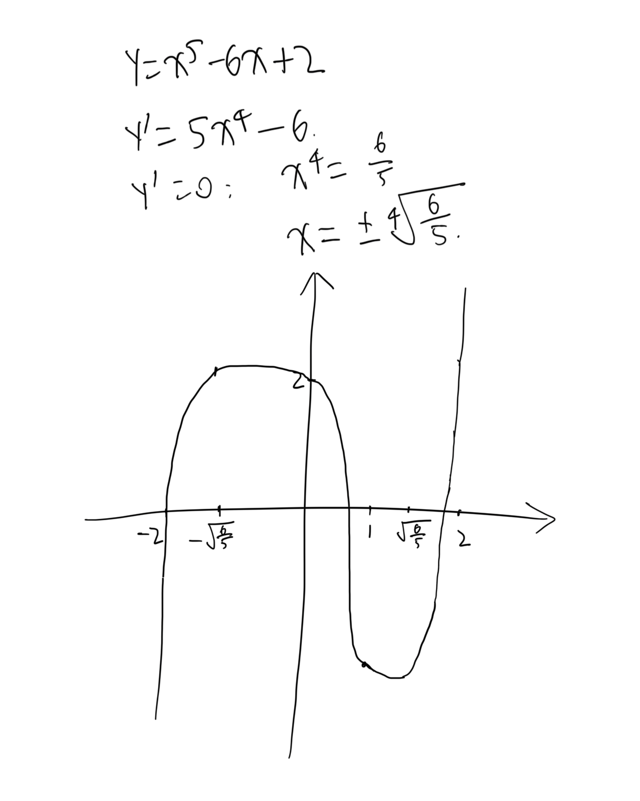
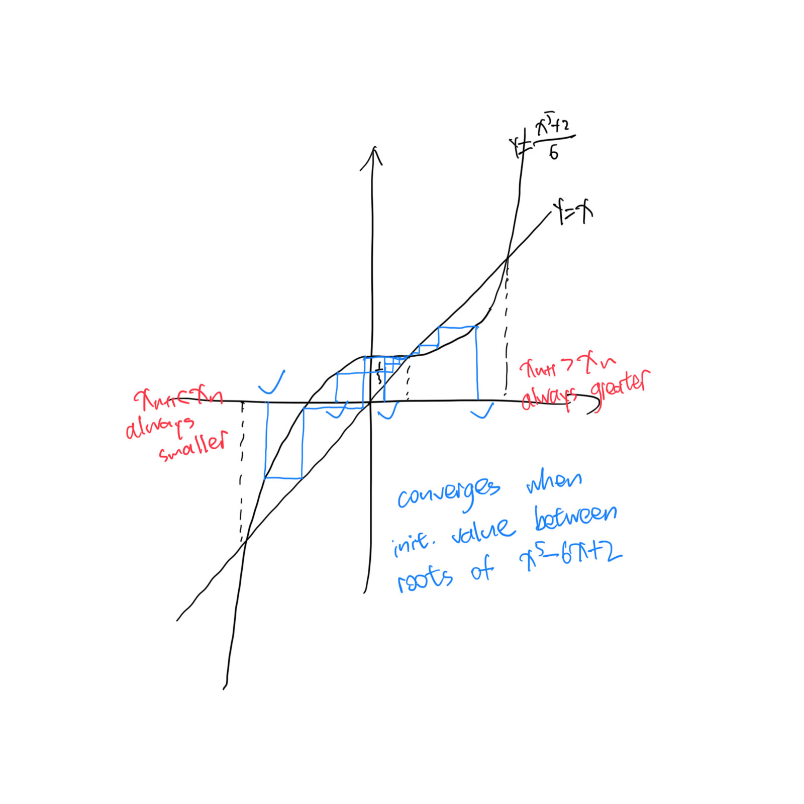

+++
# TOML Frontmatter
completed = 2026-10-20
+++

# Analysis I — Sheet 5

We use the notation $\Epsilon_\varepsilon(a)$ to express that, for a convergent sequence $(a_n)$ , given $\varepsilon > 0$ , the smallest $N \in \N$ such that $|a_n - \lim_{n \to \infin}a_n| < \varepsilon$ $\forall n \ge N$ , and $\Epsilon'_\varepsilon(a)$ for that of a Cauchy sequence.

1. $\forall m,n \in \N$ , $m > n$ , we have
   
   $$
   \begin{align*}
s_{2m} - s_{2n} 
&= \sum_{i = 2n + 1}^{2m} \frac{(-1)^{i + 1} }{2i - 1} 
\\ & = \frac{1}{4n + 1} - \frac{1}{4m-1} +
\sum_{i = 2n + 2}^{2m - 1}\frac{(-1)^{i + 1} }{2i - 1} 
\\ & < \frac{1}{4n} + \sum_{j = n + 1}^{m - 1}
\left( \frac{-1}{4j - 1} + \frac{1}{4j + 1} \right)
\\ &< \frac 1 {4n}
\end{align*}
   $$
   
   We can rewrite this as $s_m - s_n < \frac{1}{2n-2}$ .
   
   Then, given $\varepsilon > 0$ , let $N = 1000\lceil\frac{1}{\varepsilon}\rceil + 1000$ , then $\forall m, n \in \N$ and $m \ge n \ge N$ ,
   
   $$
   |s_m - s_n|  = s_m - s_n
\le s_m - s_N
< \frac{1}{2N - 2}
< \varepsilon
   $$
   
   Therefore $(s_n)$ is Cauchy.
   
   $L > \frac 2 3$ because the first two terms gives $\frac 2 3$ and the tail is positive by combining two adjacent terms.
   
   By calculation, $s_6 < 0.75$ , $s_n - s_6 < 0.1$ $\forall n \ge 6$ , and $\frac{13}{15} > 0.85$ . Therefore $L < \frac{13}{15}$ for otherwise there will be an $s_n > 0.85$ . $\square$ 

2. As for $(x_n + y_n)$ , for $\varepsilon > 0$ , let $N = \max(\Epsilon'_{\frac \varepsilon 2}(x) , \Epsilon'_{\frac \varepsilon 2}(y))$ , then $\forall m \ge n \ge N$ , we have
   
   $$
   (x_m + y_m) - (x_n + y_n)
= (x_m - x_n) + (y_m - y_n)
< \varepsilon_x + \varepsilon_y = \varepsilon
   $$
   
   Therefore $(x_n + y_n)$ is Cauchy.
   
   As for $(cx_n)$ , given $\varepsilon > 0$ , $\forall m \ge n \ge \Epsilon'_{\frac \varepsilon c}(x)$ we have $(cx_m) - (cx_n) = c(x_m - x_n) < c\varepsilon_x = \varepsilon$ , then $(cx_n)$ is Cauchy.
   
   As for $(x_n y_n)$ , for $\varepsilon > 0$ , let $N = \max(\Epsilon'_{\sqrt \varepsilon}(x) , \Epsilon'_{\sqrt \varepsilon}(y))$ and do the same as $(x_n + y_n)$ .
   
   As for $(\frac 1 {y_n})$ , assume $y_n \to L >0$ as the procedure is essentially the same for negative ones by setting $L$ to $-L$ . For given $\varepsilon$ , let $e = \min(\frac{L}{2}, \frac{L^2 \varepsilon}{16})$ and $N = \Epsilon_e (y)$ . Then $\forall m \ge n \ge N$ , $y_m , y_n \in (L - \frac{ L^2\varepsilon}{4}, L + \frac{ L^2\varepsilon}{4})$ and $y_m, y_n \in (\frac L 2, \frac {3L} 2)$ . Therefore,
   
   $$
   \begin{align*}
\left| \frac{1}{y_m} - \frac{1}{y_n} \right|
& = \frac{|y_n - y_m|}{|y_m y_n|}
\\ & < \frac{ \frac{L^2\varepsilon}{8} }{ \frac{L^2}{4} }
\\ & = \frac \varepsilon 2
\\ & < \varepsilon
\end{align*}
   $$
   
   Thus $(\frac {1}{y_n})$ is Cauchy. $\square$ 

3. $$
   \begin{align*}
a_m - a_n & = \int_1^m \frac{\cos x}{x^2} \mathrm d x -
\int_1^n\frac{\cos x}{x^2} \mathrm d x
\\ & = \int_n^m \frac{\cos x}{x^2} \mathrm d x
\\
|a_m - a_n| & \le \int_n^m 
\left| \frac{\cos x}{x^2} \right| \mathrm d x
\\ & < \int_n^m \frac{1}{x^2} \mathrm d x
\\ & = \frac 1 n - \frac 1 m
\\ & < \frac 1 n
\end{align*}
   $$
   
   $(a_n)$ is Cauchy (for $\varepsilon>0$ we give $N = \lceil \frac 1 \varepsilon \rceil$ ) and therefore convergent.
   
   $$
   \begin{align*}
\lim_{n \to \infin}
\int_{1}^n \frac{\sin x}x
\mathrm d x
& = \int_1^{\infin}
\frac{\sin x} x \mathrm d x
\\ & = \int_1^{\pi}
\frac{\sin x} x \mathrm d x + 
\sum_{i=1}^{\infin}
\int_{i\pi}^{ (i + 1)\pi } \frac{\sin x}{x} \mathrm d x
\end{align*}
   $$
   
   And the integral converges because by Alternating Series Test $\sum_{i=1}^{\infin}
   \int_{i\pi}^{ (i + 1)\pi } \frac{\sin x}{x} \mathrm d x$ converges.

4. (i) For $\varepsilon$ , let $N = \max(\Epsilon_\varepsilon(a_{2n}), \Epsilon_{\varepsilon}(a_{2n + 1}) )$ , then $|a_{2n} - L| < \varepsilon$ and $|a_{2m + 1}| < \varepsilon$ $\forall 2n \ge N, 2m+ 1 \ge N$ , therefore $|a_n - L| < \varepsilon$ $\forall  n \ge N$ . $\square$ 
   
   (ii) Let $(b_{2n}) \to L$ . Then $(b_{6n}) \to L$ because it is contained in $(b_{2n})$ , and $(b_{3n}) \to L$ because it contains $( b_{6n} )$ . Also, the sequence $(b_{3(2n + 1)}) \to L$ because it is contained in $(b_{3n})$ , thus $(b_{2n + 1}) \to L$ because it contains $(b_{3(2n + 1)})$ . Therefore by (i) $(b_n)$ converges. $\square$ 
   
   (iii) As a counterexample,
   
   $$
   c_n = \begin{cases}
n & \text{prime}\\
0 & \text{otherwise}
\end{cases}
   $$
   
   (iv) Reuse the counterexample defined in (iii), all subsequences that does not contain a prime-indexed term are convergent, and there are uncountably many of them.

5. (i) Handwritten.
   
   
   
   (ii) If $(x_n)$ converges then $\lim_{n \to \infin} \frac{x_{n + 1} }{x_n} = 1$ , $\lim_{n\to \infin} \frac{ {x_n}^5 + 2 }{6x_n} = 1$ , and $\frac{ {\lim_{n \to \infin}x_n}^5 + 2 }{ 6\lim_{n \to \infin}x_n } = 1$ . With $L = \lim_{n \to \infin} x_n$ we know $L^5 - 6L + 2 = 0$ . $\square$ 
   
   (iii) Handwritten.
   
   
   
   (iv) By induction.
   
   - $x_1 = 0 \in [0, 1)$ .
   
   - If $x_i \in [0, 1)$ $\forall i \le n$ , then $x_{n + 1} = \frac{ {x_n}^5 + 2 }{6} \in [\frac 1 3, \frac 1 2) \subseteq [0, 1)$ .
   
   Therefore $0 \le x_n < 1$ for all $n$ .
   
   $$
   \begin{align*}
|x_{n + 1} - x_n | &= \left| \frac{ {x_n}^5 + 2 }{6} - 
\frac{ { x_{n - 1}^5 + 2 } }{6}
\right|
\\ &= \frac 1 6 | {x_n^5} - { x_{n-1}^5 } |
\\ &= \frac 1 6 |x_n - x_{n - 1}| \left| \sum_{i=0}^4 {x_n}^i
{x_{n-1} }^{4-i}
\right|
\\ & \le \frac 5 6 |x_n - x_{n - 1}|
\end{align*}
   $$
   
   Then by induction $|x_{n+1} - x_n| \le \frac 1 3(\frac 5 6)^{n - 1}$ . $\square$ 
   
   (v) 
   
   $$
   \begin{align*}
|x_n - x_m|  &\le \sum_{i=m}^{n-1} |x_ {i+1} - x_i|
\\ & = \sum_{i=m}^{n-1} \frac 1 3 \left( \frac 5 6 \right)^{i-1}
\\ & = \frac 1 3 \sum_{i=m}^{n-1} \left( \frac 5 6 \right)^{i-1}
\end{align*}
   $$
   
   And
   
   $$
   \begin{align*}
\frac 1 3 \sum_{i=m}^{n-1} \left( \frac 5 6 \right)^{i-1}
& = \frac 1 3 \left( \frac 5 6 \right)^{ m - 1 } 
\frac{ 1- \left( \frac 5 6 \right)^{n-m} }{ 1 - \frac 5 6 }
\\ & = \frac 1 3 \left( \frac 5 6 \right)^{ m - 1 } 6
\left(   1- \left( \frac 5 6 \right)^{n-m}\right)
\\ \le 2\left( \frac 5 6 \right)^{ m - 1 } \space \square
\end{align*}
   $$
   
   (vi) $\lim_{n \to \infin} x_n$ is a root of $L^2 - 6L + 2 = 0$ . Since $x_n \in [0, 1)$ $\forall n \in \N$ it can only tend to the root between $[0, 1)$ , or, $\beta$ . $\square$ 
