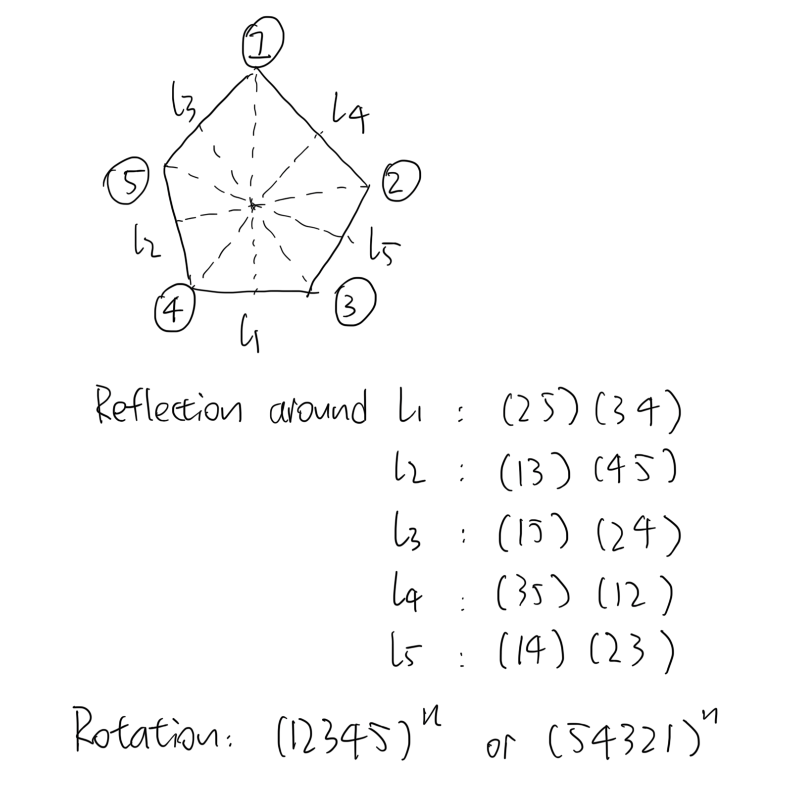

+++
# TOML Frontmatter
+++

# Groups and Group Actions — Sheet 2

1. Because
   
   $$
   \alpha = (1\;12) (2\;6\;8) (3\;5\;4\;7\;11\;10\;9)
\\
\beta = (1\;12) (2\;11)(3\;10)(4\;9)(5\;8)(6\;7)
\\
\gamma = (1\;2\;3\;4\;5\;6)(7\;9\;8\;10\;12\;11)
   $$
   
   $|\alpha| = 42$ , $|\beta| = 2$ , $|\gamma| = 6$ .
   
   $\alpha$ is odd, $\beta$ and $\gamma$ are even.
   
   $$
   \alpha^2 = (2\;8\;6)(3\;4\;11\;9\;5\;7\;10)
\\
\alpha\beta = (2\;10\;5) (3\;9\;7\;8\;4) (6\;11)
\\
\gamma^{-1} = (6\;5\;4\;3\;2\;1) (11\;12\;10\;8\;9\;7)
   $$

2. | Type                 | Count |
   | -------------------- | ----- |
   | Identity             | 1     |
   | 2-cycle              | 6     |
   | 3-cycle              | 8     |
   | 4-cycle              | 6     |
   | Double Transposition | 3     |
   
   In $\mathrm A_5$ ,
   
   | Type                 | Count |
   | -------------------- | ----- |
   | Identity             | 1     |
   | 3-cycle              | 20    |
   | 5-cycle              | 24    |
   | Double Transposition | 15    |

3. For $x \in \{1,\cdots n\}$ , let $x = y\sigma$ since $\sigma$ is bijective, then
   
   $$
   \text{LHS} = x\sigma^{-1}(1 \;2\;3\cdots k)\sigma
= y\sigma\sigma^{-1}(1\;2\;3\cdots k)\sigma
= y(1\;2\;3\cdots k)\sigma
   $$
   
   $$
   \text{RHS} = x(1\sigma\;2\sigma\cdots k\sigma)
= y\sigma(1\sigma\;2\sigma\cdots k\sigma)
= y(1\;2\;3 \cdots k)\sigma = \text{LHS}
\space \square
   $$
   
   $$
   (\alpha\beta^5\gamma^3\alpha^2\gamma\beta^3\alpha^5)^3 = \operatorname{id}
   $$

4. (i)
   
   | $\sigma$ | $\tau$ | $\sigma\tau$ | $\operatorname{sgn}\sigma$ | $\operatorname{sgn}\tau$ | $\operatorname{sgn}(\sigma\tau)$ |
   | -------- | ------ | ------------ | -------------------------- | ------------------------ | -------------------------------- |
   | Even     | Even   | Even         | $1$                        | $1$                      | $1$                              |
   | Even     | Odd    | Odd          | $1$                        | $-1$                     | $-1$                             |
   | Odd      | Even   | Odd          | $-1$                       | $1$                      | $-1$                             |
   | Odd      | Odd    | Even         | $-1$                       | $-1$                     | $1$                              |
   
   $\square$ 
   
   (ii) Let $p$ be a permutation such that $|p| = 2m + 1$ and $p^{2m + 1} = 1$ . Then $\operatorname{sgn}p^{2m + 1} = (\operatorname{sgn}p)^{2m + 1} = 1$ and $\operatorname{sgn}p = 1$ , therefore $p$ is even. $\square$ 
   
   The converse does not hold by considering $(1\;2)(3\;4)$ which is even but has order $2$ .
   
   (iii) Every symmetry of the pentagon corresponds to an even permutation because every reflection is a product of two transpositions and every rotation is the power of an even permutation.
   
   
   
   $\square$ 
   
   If the vertices are arbitrarily labelled, there are 120 ways to label but $|\mathrm A_5| = 60$ .

5. (i) Let $a = (1\;2)(3\;4)$ , $b = (1\;3)(2\;4)$ , $c = (1\;4)(2\;3)$ . By calculation,
   
   |     | $e$ | $a$ | $b$ | $c$ |
   | --- | --- | --- | --- | --- |
   | $e$ | $e$ | $a$ | $b$ | $c$ |
   | $a$ | $a$ | $e$ | $c$ | $b$ |
   | $b$ | $b$ | $c$ | $e$ | $a$ |
   | $c$ | $c$ | $b$ | $a$ | $e$ |
   
   And this is symmetric around the main diagonal. $\square$ 
   
   (ii) Because the only Abelian groups of order 4 are $\Z_4$ and $\Z_2 \times \Z_2$ and $\Z_4$ does not have 3 elements of order 2, $V_4 \cong \Z_2 \times \Z_2$ . $\square$ 
   
   (iii) 6.

6. (i) $\alpha = (2\;4\;5\;7\;1\;3\;6)$ . $\alpha$ is unique because $\alpha^{28} = 1$ and $|\alpha| \mid 28$ . Because the order of a permutation is the least common multiple of lengths of disjoint circles $\alpha \in \mathrm S_7$ cannot have order 28. Obviously $|\alpha| \ne 1$ , and $|\alpha| \ne 4$ because $\alpha^4 \ne 1$ , then $|\alpha| = 7$ and $\alpha$ can only be a 7-cycle. Writing $\alpha = (a\;b\;c\;d\;e\;f\;g)$ and $\alpha^4 = (a\;e\;b\;f\;c\;g\;d)$ gives unique solution.
   
   (ii) Because $\alpha^{12} = 1$ , $\alpha^3 \ne 1$ , $\alpha^6 \ne 1$ , and obviously $\alpha^2 \ne 1$ , $|\alpha| = 4$ . Then $\alpha$ must be a 4-cycle, otherwise, since it can only contain 4 and 2-cycles when written as composition of disjoint cycles, the 2-cycles will not cancel in $\alpha^3$ and cannot give a single 4-cycle. Then by calculation $\alpha = (1\;4\; 3\; 2)$ .
   
   (iii) Considering the disjoint cycle representation, obviously $\alpha$ and $\beta$ are both 3-cycles and $\alpha\beta$ is a 5-cycle. Then the intersection of $\alpha$ and $\beta$ can only have exactly one element. Let $\alpha = (e\;a\;b)$ and $\beta = (e\;c\;d)$ . Then $\alpha\beta = (e\;a\;b\;c\;d)$ is a 5-cycle. Therefore any two 3-cycles that intersect at exactly one element will suffice.
   
   (iv)
   
   $$
   (2\;3\;\cdots n\;1)
= \prod_{i=1}^{\lceil \frac n 2 \rceil} (i\quad n +1-i)
\prod_{i=1}^{\lceil \frac{n-1}{2} \rceil } (i \quad n-i)
   $$
