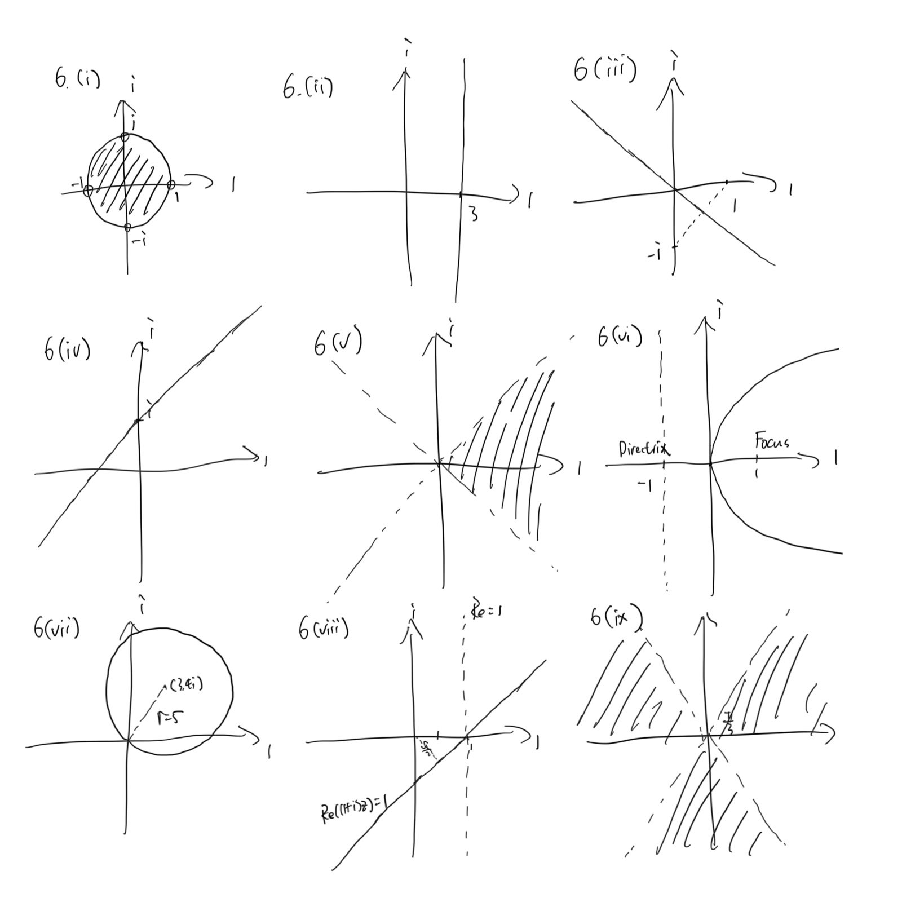

+++
# TOML Frontmatter
+++

# Problem Sheet 1

1. $2x^2 -6x + 9 = 0$ and $-4x^2 + 7x - 9 = 0$ .

2. Because $\mathbb C$ is a field it has no zero-factors.
   
   $|z||w| = |zw| = 0 \implies |z | = 0 \lor |w | = 0 \implies z = 0 \lor w = 0$ .

3. $5-5\mathrm i$ , $5 + 5\mathrm i$ , $\frac{1 + 7\mathrm i}{4}$ , $-4$ .

4. $2 \angle \frac{\pi}3$ , $5 \sqrt 2 \angle \arctan \frac{1}{7}$ , $4\sqrt 2 \angle \frac{5\pi}4$ , $-5 \mathrm i$ .

5. $-5 - 12\mathrm i = 13 \angle (\pi + \arctan \frac{12}{5})$ .
   
   The two square roots are $\sqrt {13} \angle (\frac{\pi}{2} + \frac{1}{2} \arctan \frac{12}5 ) = -2 + 3 \mathrm i$ and $\sqrt {13} \angle ( \frac{3\pi}2 + \frac 1 2 \arctan \frac{12}5) = 2 - 3 \mathrm i$ .
   
   $z = \frac{4 + \mathrm i \pm \sqrt { -5-12\mathrm i }}{2}$ and $z_1 = 3 - \mathrm i$ , $z_2 = 1 + \mathrm i$ .

6. Handwritten.
   
   

7. (i) $z = 1 \angle \theta$ .
   
   $$
   \begin{align*}
z + z^{-1} &= 1 \angle \theta + 1 \angle( -\theta)
\\ &= \cos \theta + \mathrm i \sin \theta + \cos (-\theta) + \mathrm i \sin (-\theta)
\\ &= 2 \cos \theta
\end{align*}
   $$
   
   $$
   \begin{align*}
z - z ^{-1} &= 1 \angle \theta - 1 \angle (-\theta)
\\ &= \cos \theta + \mathrm i \sin \theta - ( \cos(- \theta) + \mathrm i \sin (- \theta) )
\\ &= 2 \mathrm i \sin \theta \space \square
\end{align*}
   $$
   
   (ii) $z^n = \operatorname{cis} (n \theta) = 1 \angle n \theta$ , $z^{-n} = \operatorname{cis}(-n\theta) = 1\angle(-n\theta) $ .
   
   Then let $\theta' = n\theta$ and apply the proof in (i). $\square$ 
   
   (iii)
   
   $$
   \begin{align*}
16 \cos ^5 \theta &= \frac{1}{2}(z + z ^{-1})^5
\\ &= \frac{1}{2} ( z ^ 5 + 5 z ^3 + 10 z + 10z^{-1} + 5z^{-3} + z^{-5})
\\ &= \frac 1 2 (z^5 + z ^{-5}) + \frac 1 2 ( 5z ^ 3 + 5z ^{-3})
+\frac 1 2 (10 z + 10z^{-1}) 
\\ &= \cos 5\theta + 5 \cos 3\theta + 10 \cos \theta \space \square
\end{align*}
   $$
   
   $$
   \begin{align*}
\int_0^{\frac \pi 2} \cos^ 5 \theta \mathrm d \theta
&= \int_0^{\frac \pi 2} \frac{1}{16}
(\cos 5 \theta + 5 \cos 3 \theta + 10 \cos \theta)
\mathrm d \theta
\\ &= \frac{1}{16}\int_0^\frac{5\pi}2 \cos \theta_1 \mathrm d \theta_1+
\frac{1}{16}\int_0^\frac{3\pi}2 5 \cos \theta_2 \mathrm d \theta_2+ 
\frac{1}{16}\int_0^\frac{\pi}2 10 \cos \theta_3 \mathrm d \theta_3
\\ &= \frac{1}{16} \sin \theta \big| _0^{\frac{5\pi}{2}} +
\frac{5}{16} \sin \theta \big| _0^{\frac{3\pi}{2}}  +
\frac{10}{16} \sin \theta \big| _0^{\frac{\pi}{2}} 
\\ &= \frac{3}{8}
\end{align*}
   $$

8. $$
   \begin{align*}
1 + \zeta + \zeta^2 + \zeta^3 + \zeta^4
&= \mathrm e^{\mathrm i \frac{0\pi}{5} }+ 
\mathrm e^{\mathrm i \frac{2\pi}{5} }+
\mathrm e^{\mathrm i \frac{4\pi}{5} }+ 
\mathrm e^{\mathrm i \frac{6\pi}{5} }+ 
\mathrm e^{\mathrm i \frac{8\pi}{5} }
\\ &= \sum_{i=0}^4 \sin \frac{2i \pi}5+ 
\mathrm i \sum_{i=0}^4 \cos \frac{2i\pi}5
\\&= 0
\end{align*} 
   $$
   
   $$
   \begin{align*}
(z - \zeta - \zeta^4) ( z - \zeta^2 - \zeta^3) 
&= (z + 1 + \zeta^2 + \zeta^3 ) (z - \zeta^2 - \zeta^3)
\\ &= z^2 - (\zeta^2 + \zeta^3) ^2 + z - \zeta^2 - \zeta^3
\\ &= z^2 + z - (\zeta^6 + 2 \zeta^5 + \zeta^4 - \zeta^2 - \zeta^3)
\\ &= z^2 + z -1
\end{align*}
   $$
   
   Let $z = 2 \cos \frac{2\pi}5$ .
   
   $$
   \begin{align*}
z ^2 + z - 1 &= (z - \zeta - \zeta^4) (z - \zeta^2 - \zeta^3)
\\ &= (\zeta + \zeta^{-1} - \zeta - \zeta^4)
(z - \zeta^2 - \zeta^3)
\\ &= 0
\end{align*}
   $$
   
   Then $z = \frac{-1 \pm \sqrt 5}{2}$ and $\cos \frac{2\pi}5 = \frac{\sqrt 5 - 1} 4$ since it is positive. $\square$ 

9. $\mathrm e^{\mathrm i \frac{\pi}7}$ , $\mathrm e^{\mathrm i \frac{3\pi}7}$ , $\mathrm e^{\mathrm i \frac{5\pi}7}$ , $-1$ , $\mathrm e^{\mathrm i \frac{9\pi}7}$ , $\mathrm e^{\mathrm i \frac{11\pi}7}$ , $\mathrm e^{\mathrm i \frac{13\pi}7}$ .
   
   We denote the seven roots as $\omega_1, \cdots, \omega_7$ .
   
   $$
   \begin{align*}
\cos \frac \pi 7 + \cos \frac{3\pi}7 + \cos \frac{5 \pi}7
& = \frac{1}{2}(\omega_1 + {\omega_1}^{-1}) + \frac{1}{2}(\omega_2 + {\omega_2}^{-1}) + \frac{1}{2}(\omega_3 + {\omega_3}^{-1})
\\ &= \frac{1}{2} ( \omega_1 + \omega_7 +
\omega_2 + \omega_6 + \omega_3 + \omega_5)
\\ &=\frac{1}{2}( - \omega_4)
\\ &= \frac{1}{2} \space \square
\end{align*}
   $$

10. (i)
    
    $$
    \begin{align*}
\zeta - \zeta^6 &= \mathrm e ^{\mathrm i \frac \pi 7} - \mathrm e ^{\mathrm i \frac {6 \pi} 7}
\\ &= \cos \frac \pi 7 + \mathrm i \sin \frac \pi 7  - \cos \frac {6\pi} 7 - \mathrm i \sin \frac {6\pi} 7
\\ &= 2 \cos \frac \pi 7
\end{align*}
    $$
    
    Similarly, $\zeta^3 - \zeta^4 = 2 \cos \frac{3\pi} 7$ and $\zeta ^ 5 - \zeta^2 = 2 \cos \frac{5\pi} 7$ .
    
    Therefore,
    
    $$
    (\zeta - \zeta^6) (\zeta^3 - \zeta^4) (\zeta^5 - \zeta^2)
= 8 \cos \frac \pi 7 \cos \frac {3\pi} 7 \cos \frac{5\pi} 7
    $$
    
    Since we can simplify using the fact $\zeta^7 = -1$ ,
    
    $$
    \begin{align*}
(\zeta - \zeta^6) (\zeta^3 - \zeta^4) (\zeta^5 - \zeta^2)
& = (\zeta ^4 + \zeta^2 - \zeta^5 - \zeta^3 )(\zeta^5 - \zeta^2)
\\& = - \zeta^2 - 1 + \zeta^ 3 +\zeta - \zeta^6 - \zeta^4 - 1 + \zeta^5
\\ & = - (\zeta^6 - \zeta^ 5 + \zeta^ 4 - \zeta^3 + \zeta^2 - \zeta + 1) - 1
\end{align*}
    $$
    
    Since $\zeta^7 + 1 = 0$ and $\zeta + 1 \ne 0$ , we know
    
    $$
    \zeta^6 - \zeta^ 5 + \zeta^ 4 - \zeta^3 + \zeta^2 - \zeta + 1 = 0
    $$
    
    and then $\cos \frac \pi 7 \cos \frac {3\pi} 7 \cos \frac{5\pi} 7 = \frac 1 8 (\zeta - \zeta^6) (\zeta^3 - \zeta^4) (\zeta^5 - \zeta^2) = - \frac 1 8$ . $\square$ 
    
    (ii) TODO
