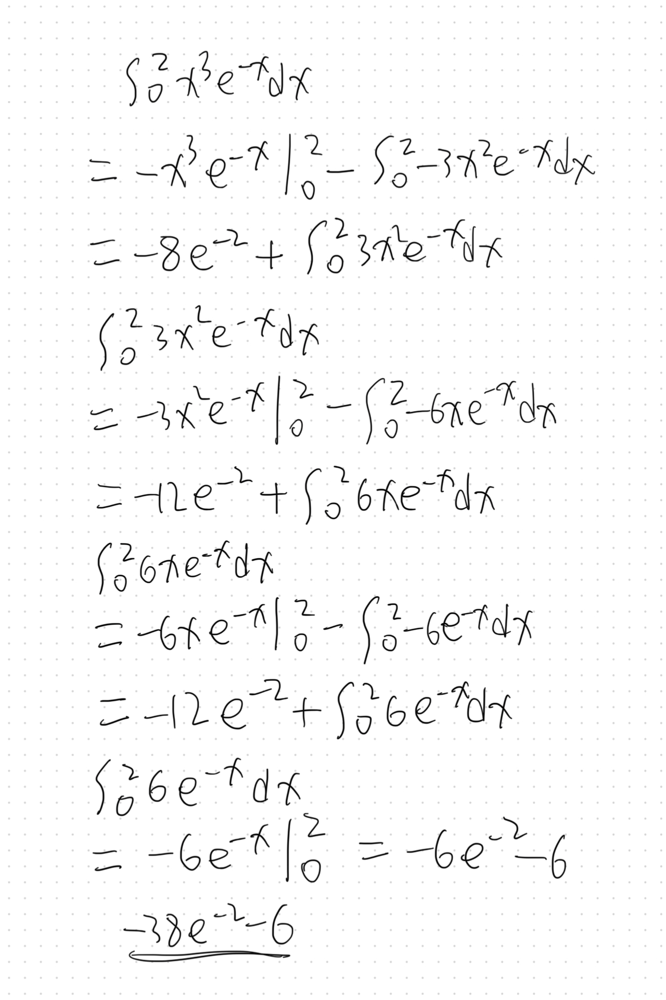
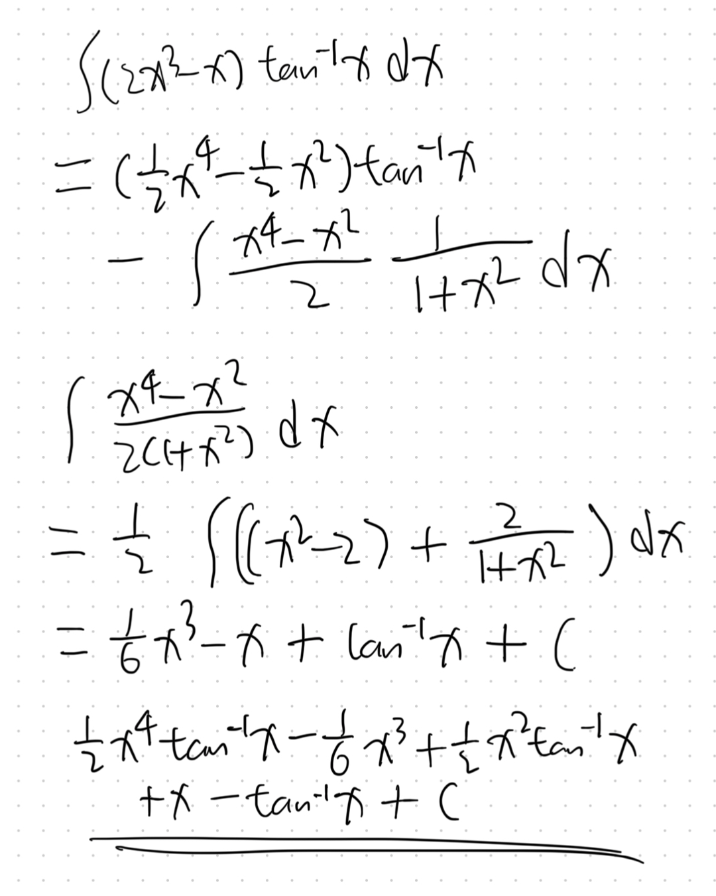
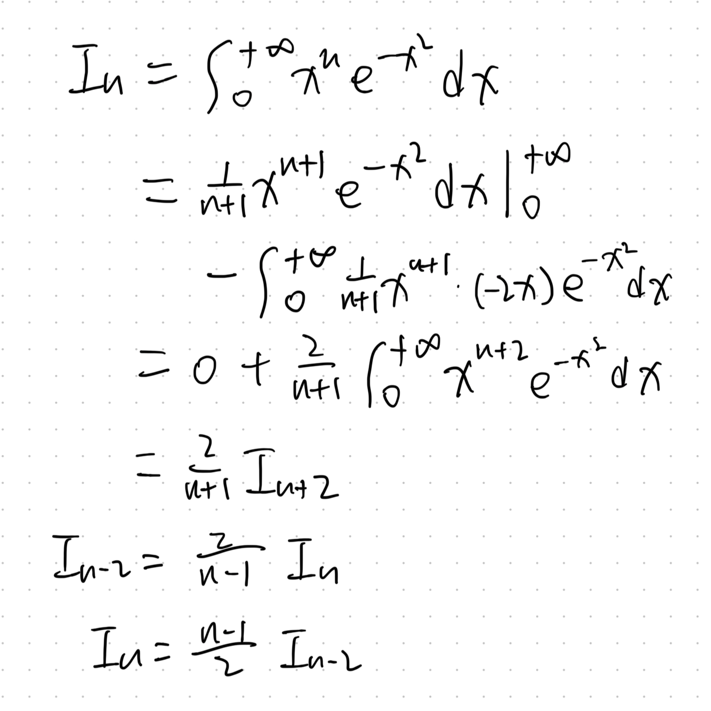
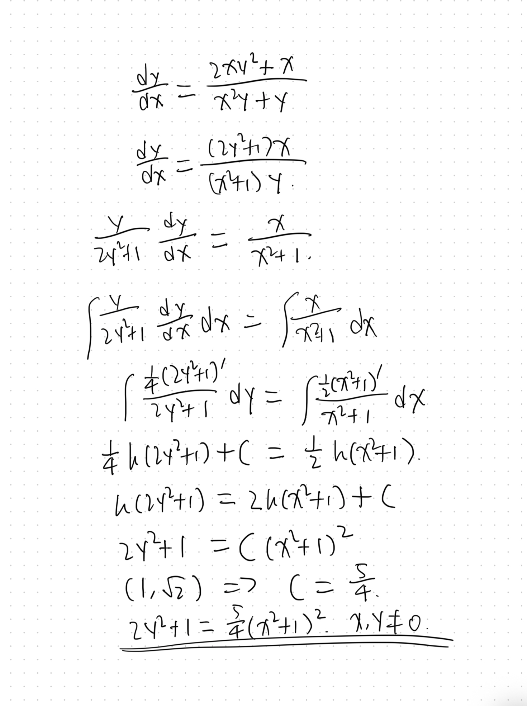
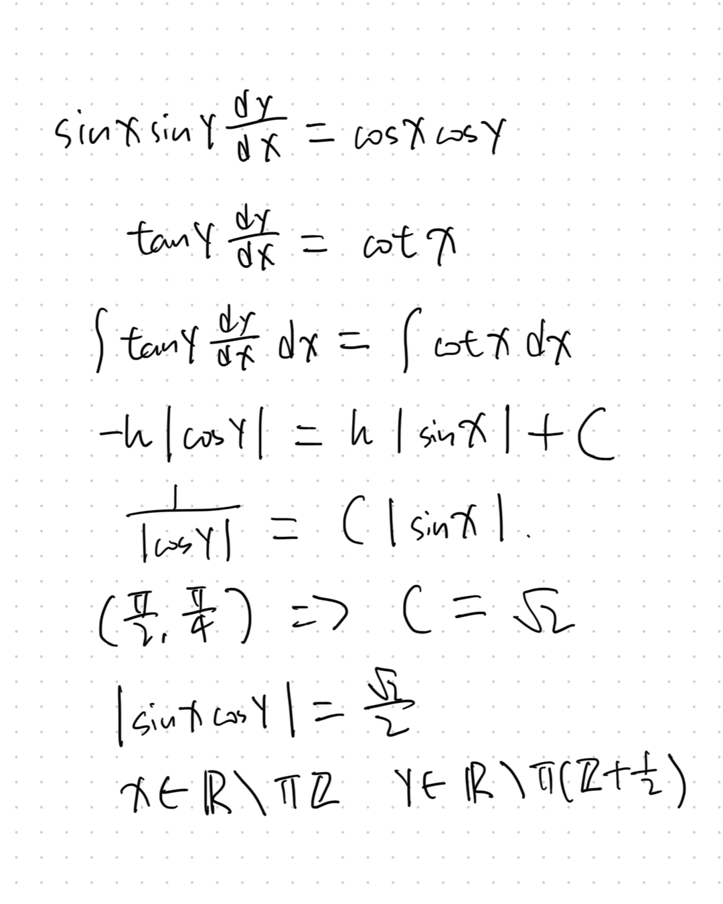
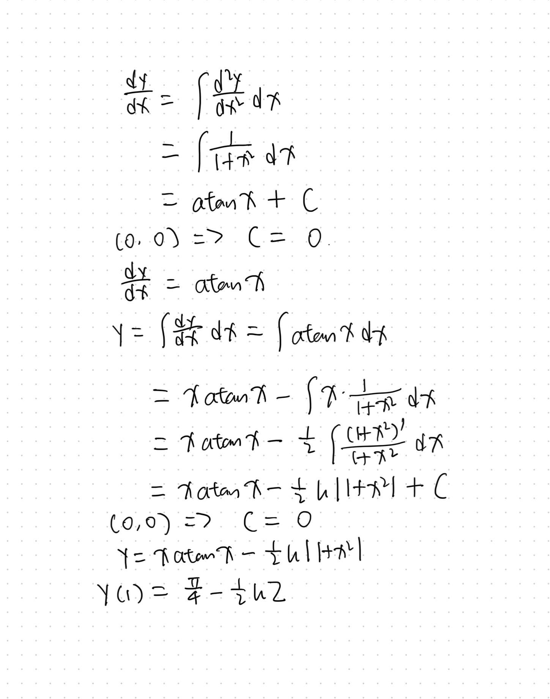
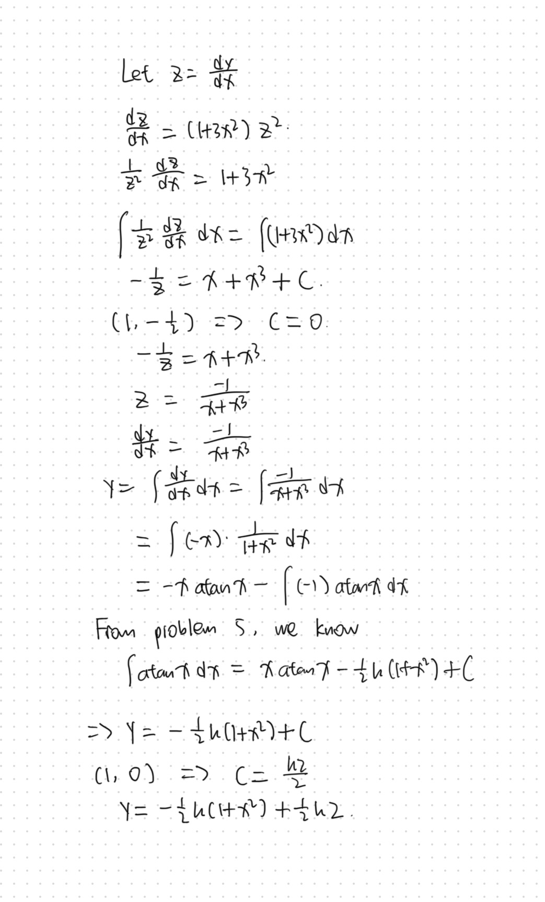

+++
# TOML Frontmatter
# Done: 2026-10-16, skipped 4
+++

# Sheet 1

1. (a)
   
   $$
   \begin{align*}
\int_0^1 \frac{1} {\mathrm e^x + 1} \mathrm d x 
& = \int_2^{\mathrm e + 1} \frac{1}{ \mathrm e^x + 1} 
\mathrm d(\mathrm e^x + 1)
\\ 
& = \ln x \big | _{2}^{\mathrm e + 1}
\\
& = \ln \left (\frac{\mathrm e + 1} 2 \right) 
\end{align*}
   $$
   
   (b) Handwritten.
   
   
   
   (c) Handwritten.
   
   

2. Handwritten.
   
   
   
   $n \in \left\{ 2n + 1 \mid n \in \N \right\}$ .
   
   $I_1 = \frac 1 2 $ , $I_3 = \frac 1 2$ , $I_5 = 1$ .
   
   $I_0 = \frac{\sqrt \pi}2$ , $I_2 = \frac{\sqrt \pi}4$ , $I_4 = \frac{3\sqrt \pi}8$ , $I_6 = \frac{15 \sqrt \pi}{16}$ .

3. (a) Handwritten.
   
   
   
   (b) Handwritten.
   
   

4. :(

5. Handwritten.
   
   

6. Handwritten.
   
   
