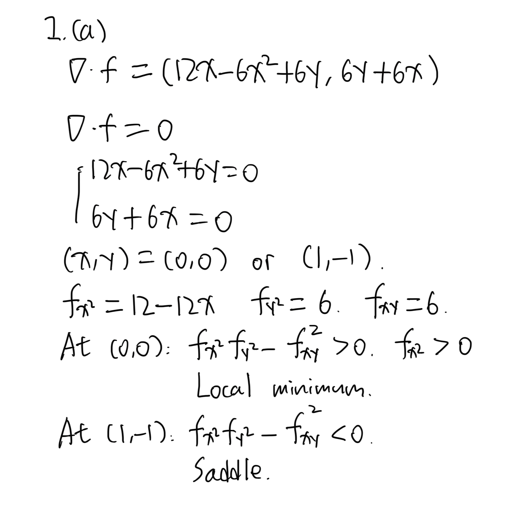
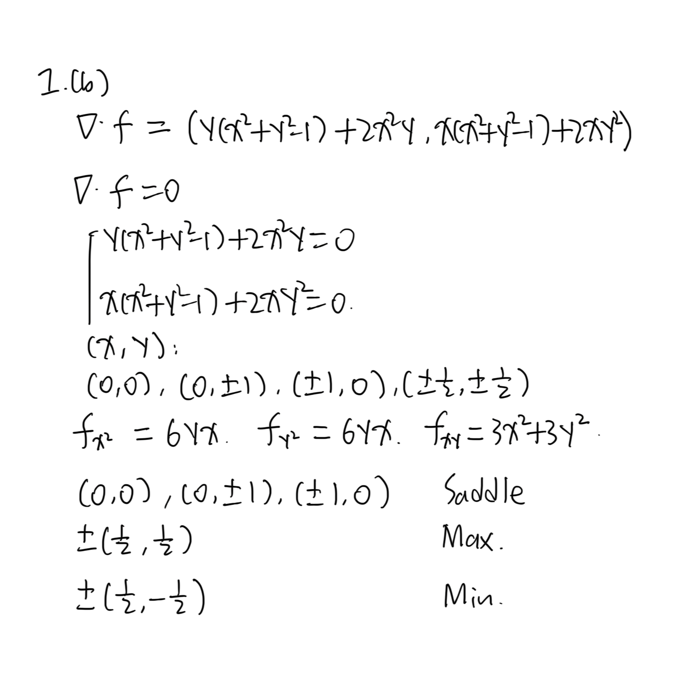
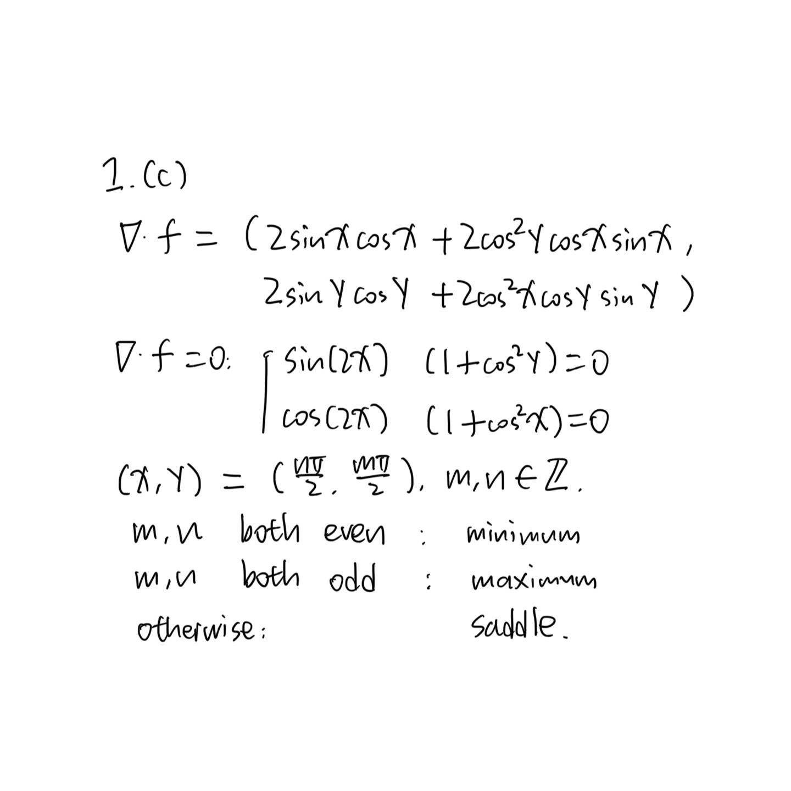
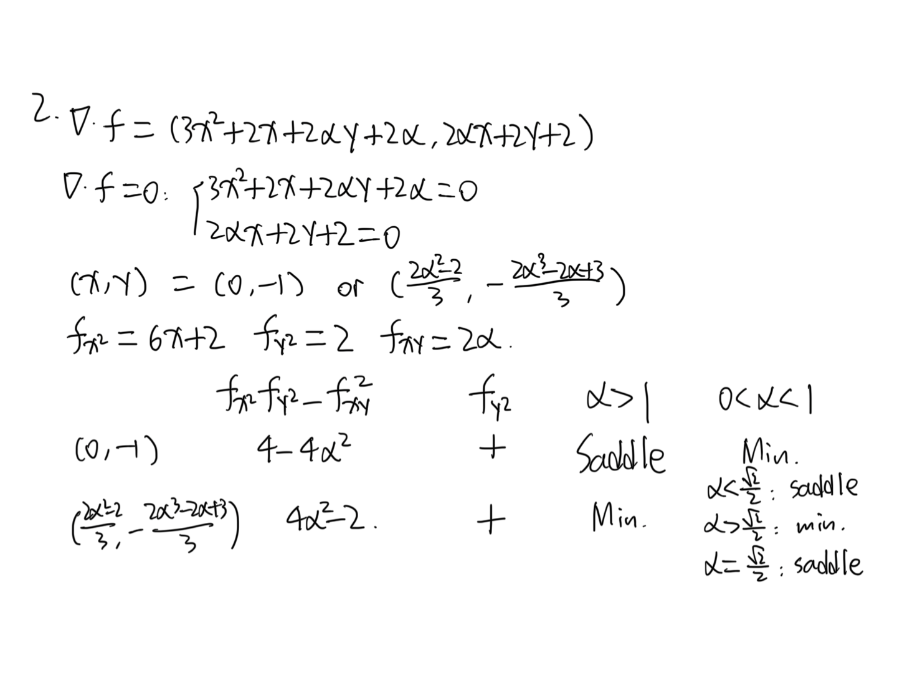
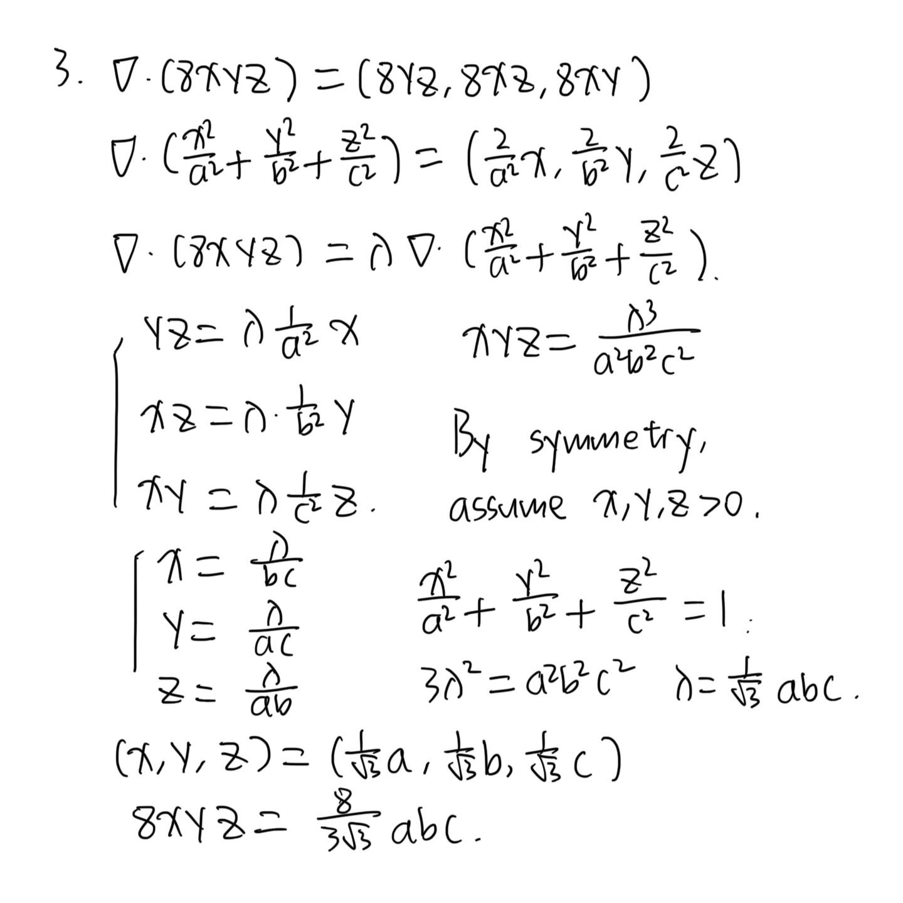
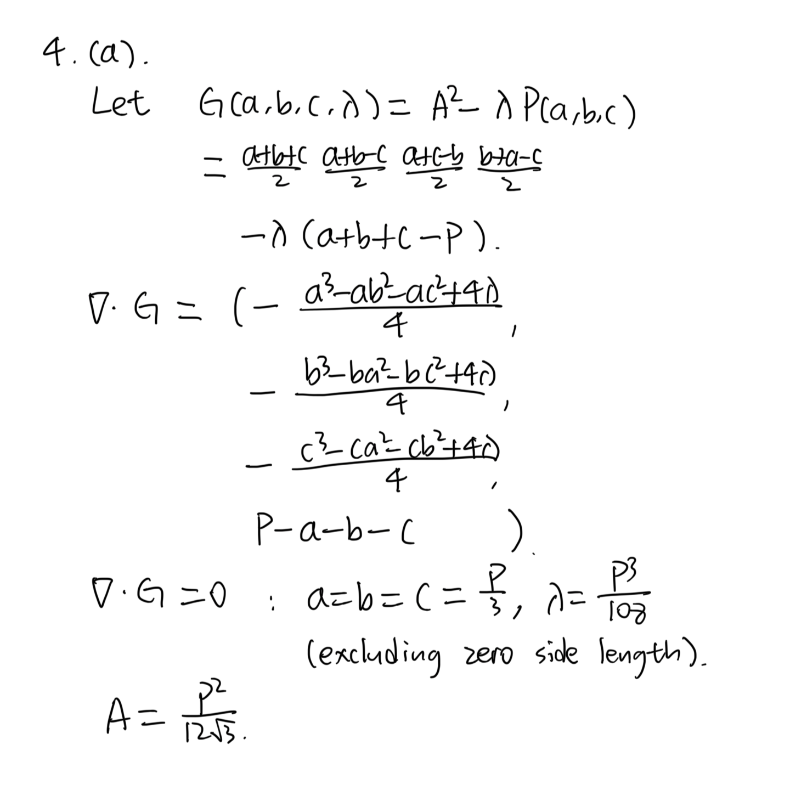
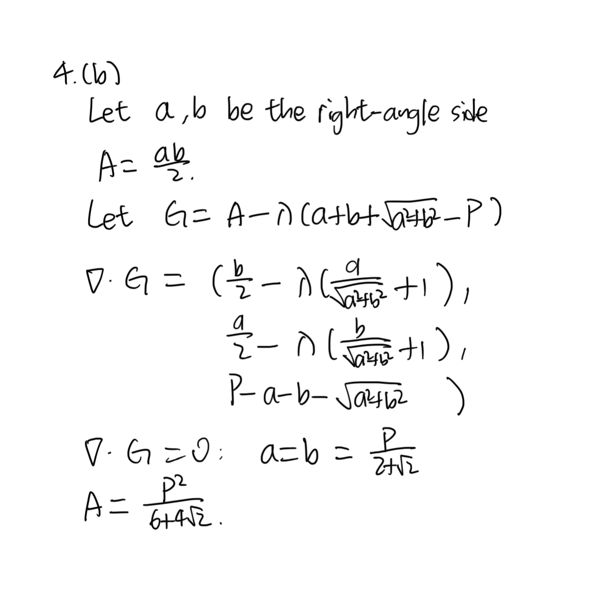
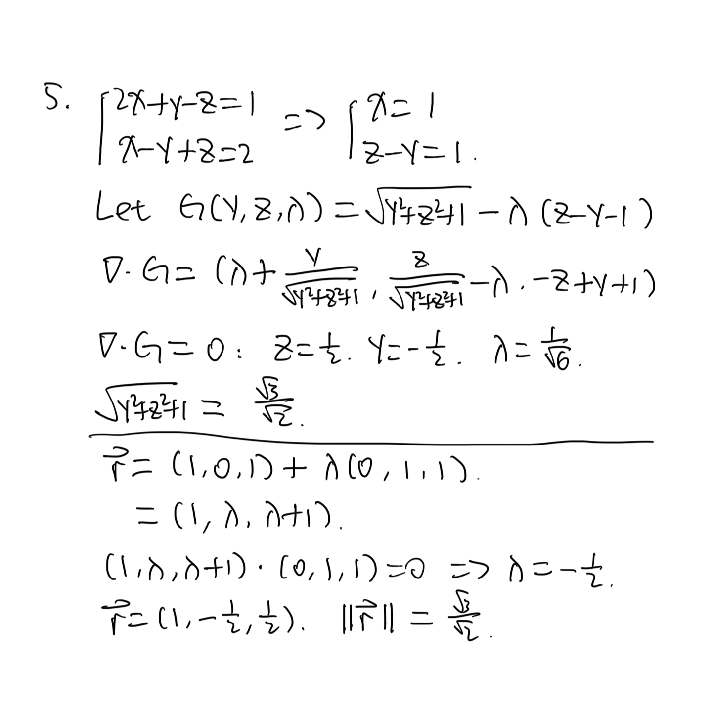
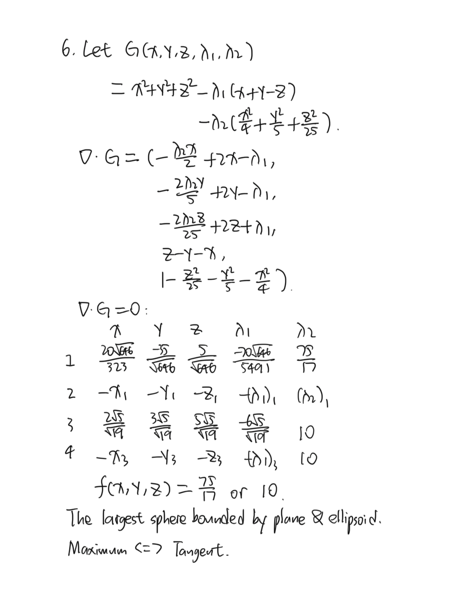

+++
# TOML Frontmatter
+++

# Introductory Calculus — Sheet 8

1. Handwritten.
   
   
   
   
   
   

2. Handwritten.
   
   

3. Handwritten.
   
   

4. Handwritten.
   
   
   
   

5. Handwritten.
   
   

6. Handwritten.
   
   
