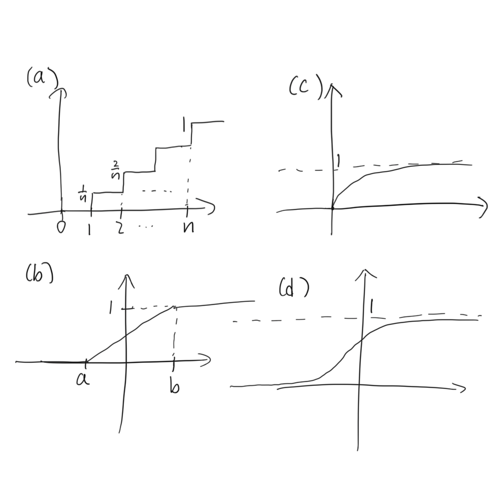

+++
# TOML Frontmatter
+++

# Probability — Sheet 7

1. Handwritten.
   
   

2. (a) $\int_0^1 cx=1$ , $c = 2$ .
   
   (b) $\int_0^1 cx^{-1} = c \ln x \big |_0^1 \to \infin$ . No such $c$ .
   
   (c) $\int_0^1 cx^{-\frac 1 2} = 2c \sqrt x \big|_0^1 = 1$ , $c = \frac 1 2$ .
   
   (d) $\int_0^1 c(4x^3 - x) = cx^4 - \frac c 2x^2 \big|_0^1 = 1$ , $c = 2$ .

3. (a) Let $f$ be density of $U$ . Obviously $f(x) = 1$ for $x \in[0,1]$ and $0$ elsewhere.
   
   $$
   \mathbb E[U] = \int_{-\infin}^\infin x f(x) \mathrm d x
= \int_{0}^1 x\mathrm d x = \frac 1 2 x^2 \big|_0^1 = \frac 1 2
   $$
   
   $$
   \begin{align*}
\operatorname{var} U &=
\int_{-\infin}^\infin (x - \mathbb E[U])^2 f(x) \mathrm d x
\\ & = \int_0^1 \left(x - \frac 1 2\right)^2 \mathrm d x
\\ & = \left(\frac 1 3 x^3 - \frac 1 2 x^2 + \frac 1 4 x\right)
\big |_0^1
\\ & = \frac{1}{12}
\end{align*}
   $$
   
   (b) Obviously $\mathbb P(U < y) = \int_{-\infin}^yf(x) \mathrm d x = y$ for $y \in [0,1]$ . Then
   
   $$
   \mathbb P(U < a \mid U < b) = 
\frac{\mathbb P(U < a, U < b)}{\mathbb P(U < b)}
= \frac{\mathbb P(U<a)}{\mathbb P(U<b)}
= \frac{a}{b}
   $$

4. (a) Let $f$ be density of $X$ .
   
   $$
   \begin{align*}
\mathbb P(X > x) &= \int_{x}^\infin f(y) \mathrm dy
\\ &= \int_x^\infin \lambda \exp(-\lambda y) \mathrm d y
\\ &= -\exp(-\lambda y) \big|_x^\infin
\\ &= \exp(-\lambda x)
\end{align*}
   $$
   
   (b)
   
   $$
   \mathbb P(a \le X \le b) = \int_a^b f(x) \mathrm d x
= \exp(-\lambda a) - \exp(-\lambda b)
   $$
   
   (c)
   
   $$
   \begin{align*}
\mathbb P(X > a + x \mid X > a)
&= \frac{\mathbb P(X > a +x, X > a)}{\mathbb P(X > a)}
\\ &=\frac{\mathbb P(X > a + x)}{\mathbb P(X > a)}
\\ & = \frac{\exp(-\lambda(a+x))}{\exp(-\lambda a)}
\\ &= \exp(-\lambda x)
\\ &= \mathbb P(X > x) \space \square
\end{align*}
   $$
   
   (d) $\sin x > \frac 1 2$ iff. $x \in (\frac 1 6 \pi + 2n\pi, \frac 5 6 \pi + 2n\pi)$ for some $n \in \Z$ .
   
   $$
   \begin{align*}
\mathbb P\left(\sin X > \frac 1 2\right)
&= \sum_{n} \mathbb P\left(
X \in\left(\frac 1 6 \pi + 2n\pi,\frac 5 6 \pi + 2n\pi \right) 
\right)
\\ &= \sum_n \left(
\exp\left(-\lambda \left( \frac \pi 6 + 2n\pi \right) \right)-
\exp\left(-\lambda \left( \frac {5\pi} 6 + 2n\pi \right) \right)
\right)
\\ &= \mathrm e^{-\frac{\lambda \pi}{6}} \sum_n \exp(-2\lambda n\pi) -
\mathrm e^{-\frac{5\lambda \pi}{6}} \sum_n \exp(-2\lambda n\pi)
\\ &=\mathrm e^{-\frac{\lambda \pi}{6}}
\times \frac{1}{1-\mathrm e^{-2\lambda\pi} } -
\mathrm e^{-\frac{5\lambda \pi}{6}}
\times \frac{1}{1-\mathrm e^{-2\lambda\pi} }
\\ &= \frac{\mathrm e^{\frac 5 6 \lambda \pi} -
\mathrm e^{\frac 1 6 \lambda \pi} }
{\mathrm e^{\lambda \pi} - \mathrm e^{-\lambda \pi} }
\end{align*}
   $$
   
   (e) By (a), $\mathbb P(cX > x) = \mathbb P(X > \frac x c) = \exp(-\frac{\lambda x}{c})$ . Then $\mathbb P(cX \le x) = 1-\exp(-\frac{-\lambda x}{c} )$ , which is by definition the c.d.f.
   
   (f)
   
   $$
   \begin{align*}
\mathbb P(X = k) &= \mathbb P(x \in (k-1,k] )
\\ &= \exp(-\lambda(k-1)) - \exp(-\lambda k)
\\ &= ( \mathrm e^\lambda - 1 ) (\mathrm e^{-\lambda})^k
\\ &= (1- \mathrm e^{-\lambda})
(1- (1-\mathrm e^{-\lambda}) )^{k-1}
\end{align*}
   $$
   
   And $\lceil X \rceil \sim \mathrm{Geom}(1- \mathrm e^{-\lambda})$ . $\square$ 

5. (a) The density of $X$ is $f(x) = \frac{1}{131\sqrt{2\pi}} \exp(-\frac{(x-315)^2}{2\times 131^2})$ .
   
   The c.d.f. of $X$ 
   
   $$
   \begin{align*}
\Phi'(x) &= \int_{-\infin}^x \frac{1}{131\sqrt{2\pi} }
\exp\left( -\frac{(x-315)^2}{2 \times 131^2} \right) \mathrm d x
\\ &= \frac{1}{131} \int_{-\infin}^x \frac{1}{\sqrt{2\pi} }
\exp\left( -\frac{ \left( \frac{x-315}{131} \right)^2}{2} \right)
\mathrm d x
\\ &= \int_{-\infin}^x \frac{1}{\sqrt{2\pi} }
\exp\left( -\frac{ \left( \frac{x-315}{131} \right)^2}{2} \right)
\mathrm d \frac{x-315}{131}
\\ &= \Phi\left( \frac{x-315}{131} \right)
\end{align*}
   $$
   
   Therefore, $\mathbb P(X < 300) = \Phi'(300) \approx \Phi(-0.115) = 0.454$ .
   
   (b)
   
   $$
   \begin{align*}
\mathbb P(X \in (300,500)) &= \Phi'(500)-\Phi'(300) 
\\ &\approx \Phi(1.412)-\Phi(-0.115) 
\\ &= 0.467
\end{align*}
   $$
   
   (c) $\mathbb P(X < 500) = \Phi'(500) = 0.921$ .
   
   $$
   0.921^{20} + {20 \choose 1}(1-0.921) \times 0.921^{19} \approx 0.524
   $$

6. Let $f$ be density of radius $R$ . Obviously $f(x) = \frac{1}{b}$ and the c.d.f. is $f^{(-1)} (x) = \frac{x}{b}$ for $x \in [0,b]$ .
   
   Obviously the area $A \in [0, \pi b^2]$ . And the c.d.f. is
   
   $$
   g^{(-1)}(x) = \mathbb P(A < x) = \mathbb P\left(R < \sqrt{\frac x \pi}\right)
= f^{(-1)} \left( \sqrt{\frac x \pi} \right) 
= \frac{1}{b\sqrt \pi} \sqrt x
   $$
   
   And the density
   
   $$
   g(x) = {g^{(-1)}}'(x) = \frac{1}{2b \sqrt{\pi x}}
   $$
   
   $$
   \mathbb E[A] = \int_{-\infin}^\infin xg(x) \mathrm d x
= \int_0^{\pi b^2} \frac{x}{2b\sqrt{\pi x} } \mathrm d x
= \frac{1}{3b \sqrt \pi}x^{\frac32} \big|_0^{\pi b^2}
= \frac 1 3 \pi b^2
   $$
   
   $$
   \begin{align*}
\operatorname{var} A &=
\int_{-\infin}^\infin (x - \mathbb E[A])^2 \mathrm d x
\\ &=\int_0^{\pi b^2} \left(x- \frac{\pi b^2}{3} \right)^2 \mathrm d x
\\ &= \left( \frac 1 3 x^3 - \frac{\pi b^2}{3} x^2 +
\frac{\pi^2 b^4}{9} x \right) \big|_0^{\pi b^2}
\\ &= \frac{\pi^3 b^6}{9}
\end{align*}
   $$

7. (a) Obviously $F_X(X) \in [0,1]$ .
   
   $$
   \begin{align*}
\mathbb P(F_X(X) \le x)
&=\int_{-\infin}^x \mathbb P(F_X(X) = y) \mathrm d y
\\ &= \int_{-\infin}^x f({F_X}^{-1}(y)) \mathrm d y
\\ &= F_X{F_X}^{-1} (x) 
\\ &= x \space \square
\end{align*}
   $$
   
   (b) The distribution is the same as $X$ .
   
   $$
   \mathbb P({F_X}^{-1}(U) < x )
= \mathbb P(U < F_X(x))
= F_X(X)
   $$
   
   (c) The c.d.f. of $X$ s are
   
   $$
   f^{(-1)}(x) = \int_0^x f(x) \mathrm d x = 1 - \exp(-\mu x)
   $$
   
   By (b) we know the $X$ s has exactly the same distribution as ${f^{(-1)}}^{-1}(U)$ s. Then we can simulate $X$ s with
   
   $$
   X_i = {f^ {(-1)} }^{-1}(U) = \frac 1 \mu \ln \left( -\frac{1}{U_i-1} \right)
   $$
